# Z NIM NIE ROBIĘ

<p align="center">
  
</p>

<p align="center">
  <b>Mat timer and automatic pair matchmaker for BJJ sparring, positional rounds, and drills.</b><br/>
  No-repeat pairings · Oversized wall clock · Triad rotations and fixed-partner drills
</p>

<p align="center">
  
  
  
  
  
</p>

<p align="center">
  <a href="https://znimnierobie.pl"><b>Open the web version (znimnierobie.pl)</b></a>
</p>

<p align="center">
  <a href="https://play.google.com/store/apps/details?id=pl.znimnierobie.app">
    
  </a>
</p>

<p align="center">
  <a href="README.md">Polski</a> · <b>English</b> · <a href="README.pt-BR.md">Português (BR)</a>
</p>

## Why this exists on the mat

Matching twenty or forty people by hand between sparring rounds eats up rest time, leaves the same friends rolling together three rounds in a row, and strands odd-numbered athletes on the wall. A standard gym clock only counts seconds down.

**Z NIM NIE ROBIĘ** ("I'm not rolling with him") puts the round clock and pair matching onto one tablet propped on the bench or mounted on the wall. Before class starts, check off who showed up from your saved club database, set your round and break lengths, and hit start. The app rings the bell, builds pairs around weight, mat experience, gi or no-gi gear, and gender, previews the next round's matchups during the break, and tracks every pairing from the current class so nobody repeats a partner until everyone has rotated through.

Everything runs offline in Polish, English, and Brazilian Portuguese. There are no accounts to create and no cloud sync, because your club roster stays in local storage on your own device.

## Recent release highlights

### Version 2.3 and Expo SDK 58 upgrade

Version 2.3 moves the runtime onto Expo SDK 58, React Native 0.88.1, React 19.3.1, AsyncStorage 3.1.1, and TypeScript 6.0.3. We replaced the retired `expo-av` package with `expo-audio` configured without microphone permissions, keeping the boxing bell, the double 10-second clapper, and automatic background music ducking intact. Interface validation hints, option tooltips, and the trilingual `/privacy` notice were also rewritten for clarity.

### Faster solver and pairing fixes in version 2.2

The matchmaking engine now uses bitmask dynamic programming and pre-indexed pair tables. Exact optimal solving covers groups up to 12 athletes (up from 10), and 46-athlete classes compute roughly 13x faster. Round countdowns now read directly from the system wall clock so backgrounded browser tabs and long rounds never drift.

We also separated `KID` and `ADULT` round-robin tracking inside `PREFER` gender matching, made it compose cleanly with weight division and `NO REST (VIP)`, and fixed mixed `KID + ADULT` rendering in positional pairs and drills as well as single-adult grouping in triads. On the roster side, the Club Database gained permanent athlete deletion, edit cancellation, comma decimal weights like `82,5` across 10 to 300 kg, browser keyboard shortcuts, and stacked mobile layouts for 360 px phones.

### Localization, visiting drop-ins, and Google Play launch (2.0 to 2.1)

Across versions 2.0 and 2.1, the Android build shipped on Google Play and every live timer label was translated into English and Brazilian Portuguese. Athlete cards gained a per-session `GUEST` switch with a purple airplane badge so visiting drop-ins get paired with home-gym members instead of each other.

Preparation cards were unified into a single color-coded grid (`KID GI`, `KID NO-GI`, `ADULT GI`, `ADULT NO-GI`, and `MIXED`), resting names stay visible in the top bar during both prep and breaks, mid-session dropouts let you pull an athlete out permanently or rest them for a single round, and root-level screen wake locks keep wall tablets lit from first bell to last.

## Four ways to run a class

### Sparring rounds

Each round steps through preparation with pair cards on screen, full-screen work countdown, and a break screen that immediately displays the newly computed pairs for the upcoming round. Coaches can spot mismatches and talk through adjustments before the next bell rings.

In the sparring options panel, you can slide between skill-first and weight-first matching across four stops, pick round progression (`MATCHED`, `VARIED`, or `RANDOM`), and set women's round behavior. On crowded mats, turning on weight division splits the room into lighter and heavier halves that alternate on the mat with a 20-second transition window.

### Positional triads

The app divides the roster into groups of three and splits each round into six equal stages. Two athletes work bottom and top while the third rests or watches the mat space around them.

| Stage | [A] BOTTOM | [B] TOP  | [C] REST |
|:-----:|:----------:|:--------:|:--------:|
| 1     | Person 1   | Person 2 | Person 3 |
| 2     | Person 1   | Person 3 | Person 2 |
| 3     | Person 2   | Person 1 | Person 3 |
| 4     | Person 2   | Person 3 | Person 1 |
| 5     | Person 3   | Person 1 | Person 2 |
| 6     | Person 3   | Person 2 | Person 1 |

After six stages, everyone in the group has worked both top and bottom against both partners. Each stage automatically takes one sixth of the configured round duration.

### Positional pairs

Pairs are matched the same way as in sparring, with each round divided into two halves. At the halfway bell, bottom and top swap roles with the same partner.

### Technique drills

Drills mode matches partners once at the start of class and keeps those pairs together through the final round, flipping A and B roles every round so both athletes get equal reps without re-adjusting to a different body type every few minutes.

## How the matchmaking solver scores pairs

Instead of shuffling names at random, the engine scores candidate pairings against a strict priority order. Groups up to 12 athletes are solved to global optimality via bitmask dynamic programming, while larger rooms use indexed beam search.

| Priority | Matching rule |
|:--------:|---------------|
| 1 | Fresh pairings first based on full session fight history |
| 2 | Separate visiting `GUEST` athletes so visitors roll with home-gym members |
| 3 | Match `GI` with `GI` and `NO-GI` with `NO-GI` (mixed gear counts as `NO-GI`) |
| 4 | Honor the selected women's pairing mode (`OFF`, `PREFER`, or `ALWAYS`) |
| 5 | Close mat skill levels (`BEG.`, `INTERM.`, `ADV.`, `PRO`) |
| 6 | Minimize body-weight difference between partners |
| 7 | Rotate odd-person sit-outs evenly while skipping `NO REST (VIP)` athletes |

Kids and adults match inside separate pools unless odd headcounts in both groups leave a single safe crossover pair as the only way to keep two people off the wall. When a long open-mat session eventually exhausts every unique combination, the solver picks the pair that rolled together furthest back in the session.

## App walkthrough

### Language picker on first launch

Pick Polish, English, or Brazilian Portuguese when opening the app for the first time, or switch languages anytime from the bottom bar.

<p align="center">
  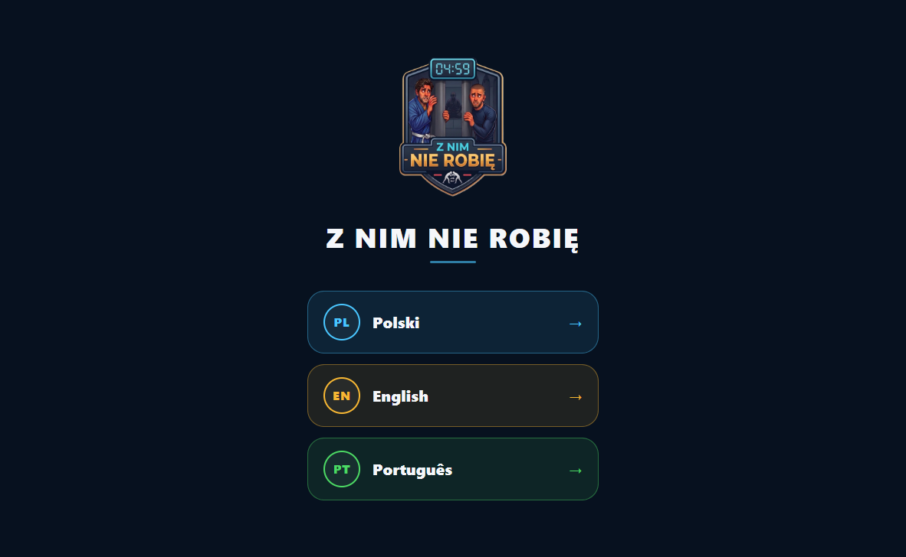
</p>

### Empty start screen before class

Add athletes, set round timing, and choose your training mode on the left while the right side holds your active mat lineup.

<p align="center">
  
</p>

### Adding and editing an athlete card

Enter nickname and weight, then pick age category, gear, gender, skill level, and optional guest status. Tapping any tile on the mat loads that athlete back into the form for quick edits.

<p align="center">
  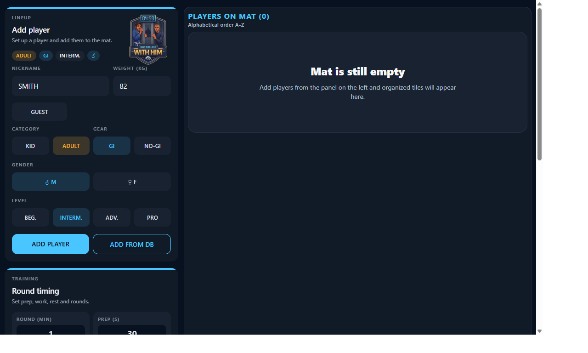
</p>

### Searching the club database

Saved gym members stay in local storage between classes. Filter by nickname or delete outdated entries permanently with the trash button.

<p align="center">
  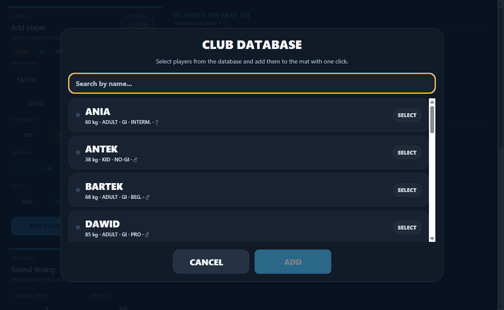
</p>

### Batch-adding today's class

Check off everyone who stepped onto the mat today and drop the whole group into the lineup with a single tap.

<p align="center">
  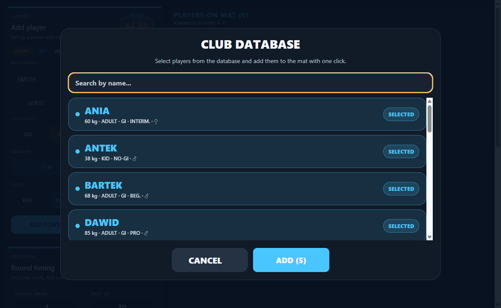
</p>

### Alphabetical mat lineup with quick filters

Lineup tiles sort A to Z and can be filtered at the top by age category, gi or no-gi gear, and skill level.

<p align="center">
  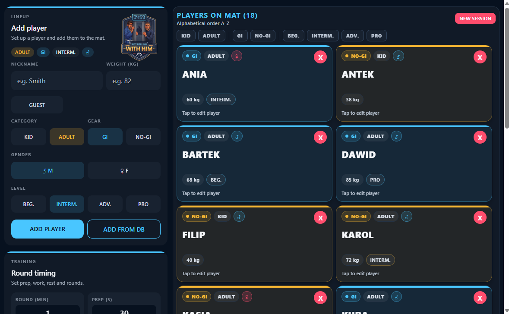
</p>

### Sparring options panel

Configure no-rest VIP athletes, the skill-versus-weight slider, round order, two-group weight division, and women's round behavior.

<p align="center">
  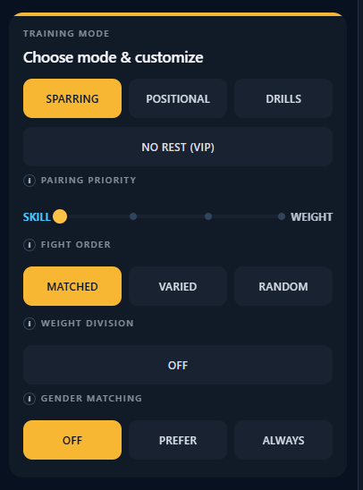
</p>

### Positional mode selector for triads and pairs

Switching to positional rounds reveals the toggle between three-person 6-stage groups and two-person mid-round swaps.

<p align="center">
  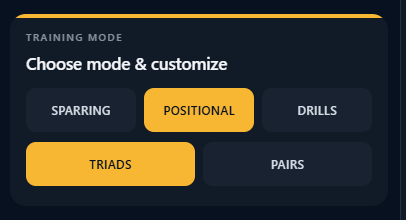
</p>

### Drills mode setup

Fixed-partner setup where pairs stay locked for the whole session and alternate A and B roles each round.

<p align="center">
  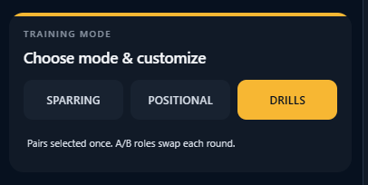
</p>

### Sparring preparation grid

Color-coded pair cards and countdown before round 1 starts so everyone finds their partner quickly.

<p align="center">
  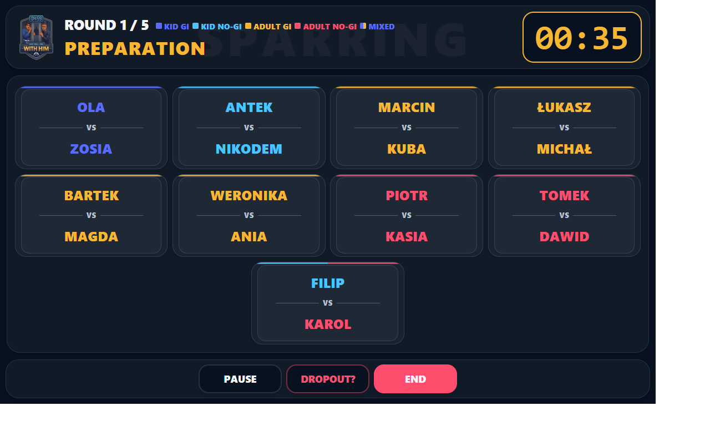
</p>

### Full-screen sparring work clock

High-contrast round clock legible from across the room with pause, mid-round dropout, and end controls underneath.

<p align="center">
  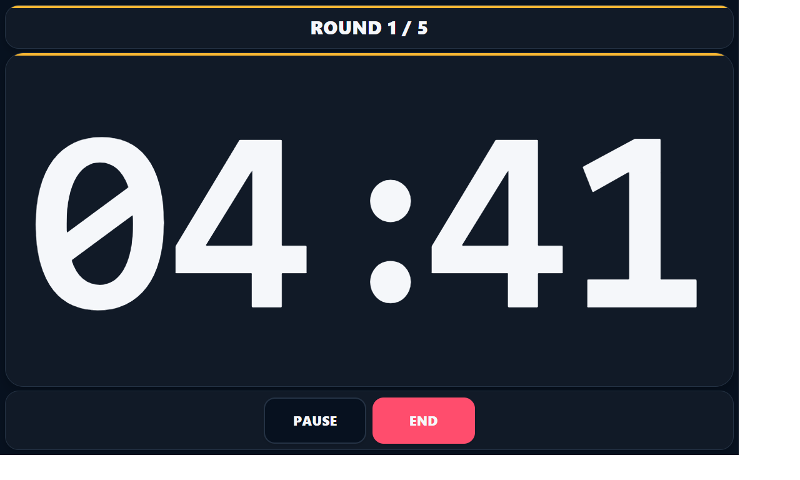
</p>

### Break screen with next-round pair preview

As soon as a round ends, the break screen displays the next round's pairs and anyone sitting out.

<p align="center">
  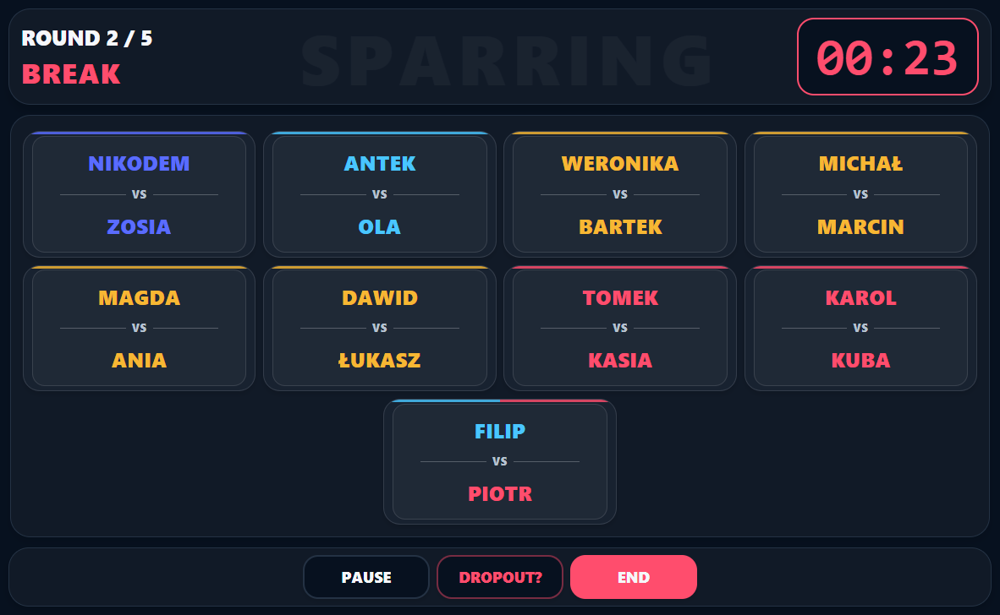
</p>

### Triad preparation cards

Three-person group cards showing who starts on bottom, on top, and resting or assisting.

<p align="center">
  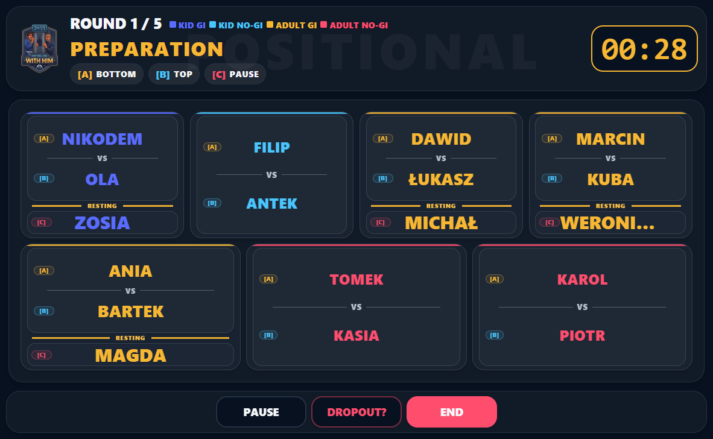
</p>

### Triad stage clock and next rotation prompt

Stage countdown showing active roles right now alongside who rotates in on the next bell.

<p align="center">
  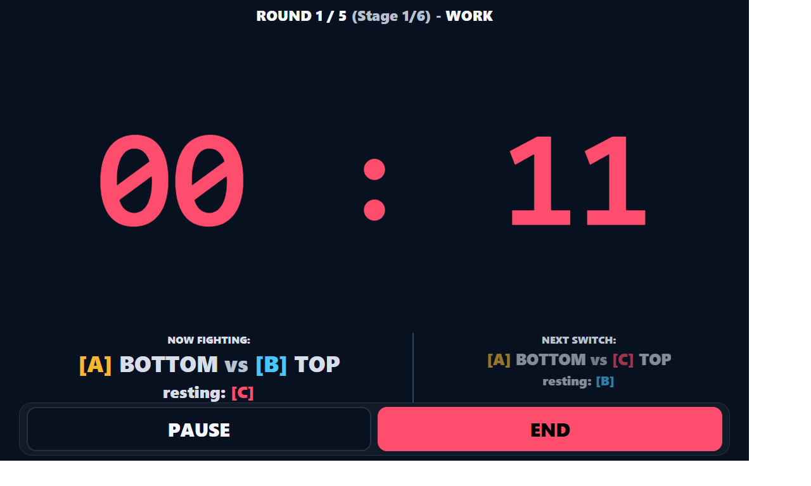
</p>

### Pair positional preparation grid

Side-by-side A and B pair cards before the first half of a positional round begins.

<p align="center">
  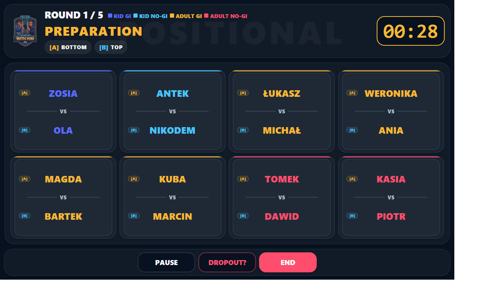
</p>

### Pair positional stage clock

Countdown for stage 1 of 2 with current roles and the upcoming swap shown right under the digits.

<p align="center">
  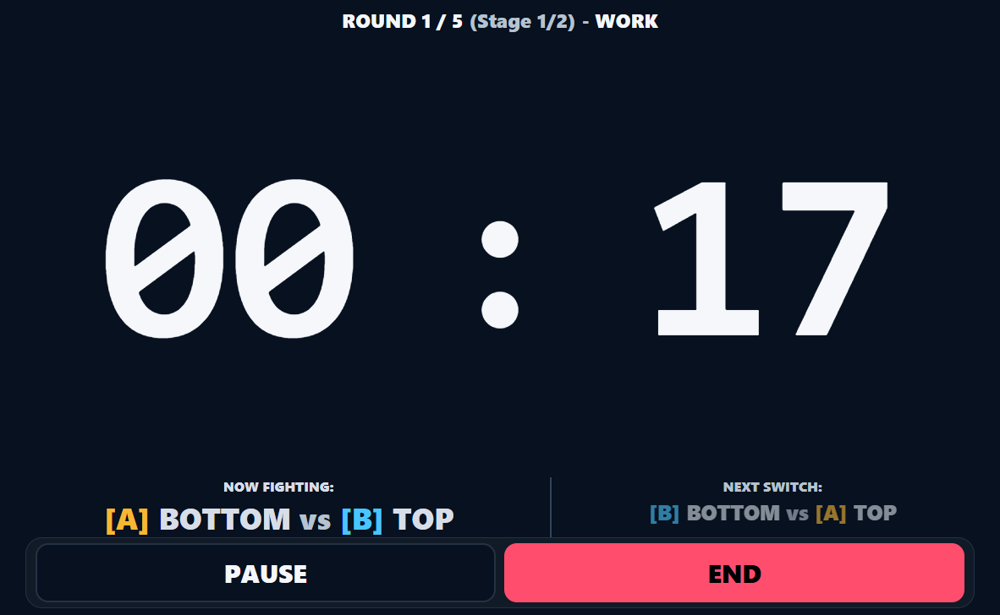
</p>

### Mid-session athlete dropout modal

Pause the clock anytime to pull injured or exhausted athletes out for the rest of class or sit them out for just one round, recalculating pairs on the spot.

<p align="center">
  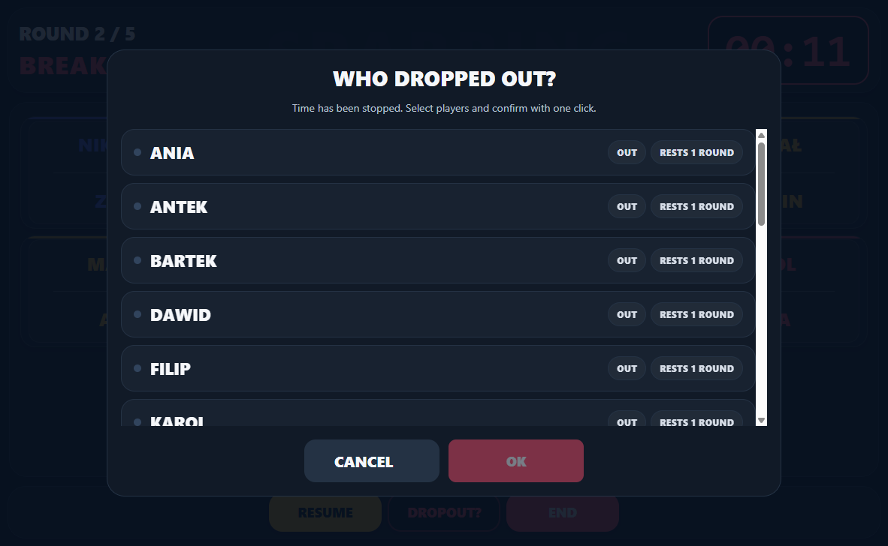
</p>

### No-rest VIP selection

Tap athlete pills to keep coaches or competition-prep athletes rolling every round without sitting out on odd headcounts.

<p align="center">
  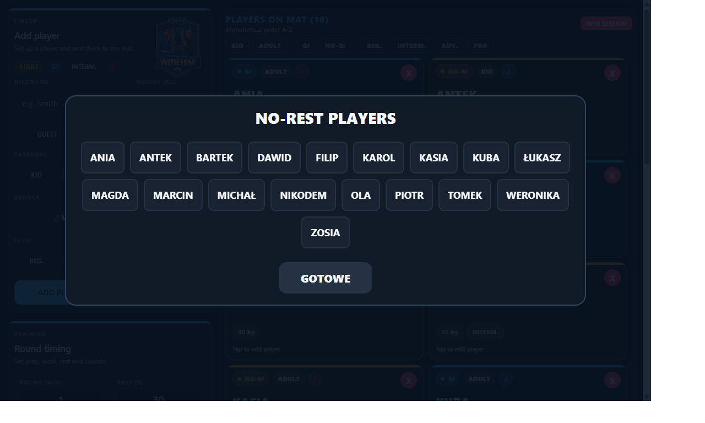
</p>

### Version and contact card

Quick dialog with the current release number, direct email link, GitHub repository, and mantoshop.pl link.

<p align="center">
  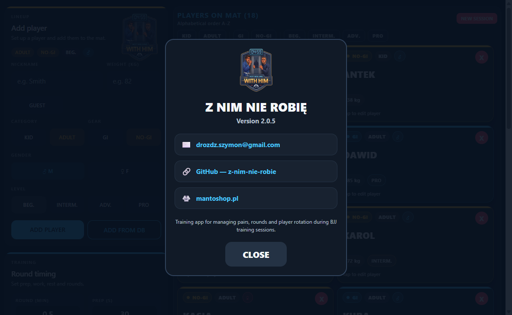
</p>

### End-of-class screen

Clean wrap-up screen after the final applause cue with one-tap return to the setup view.

<p align="center">
  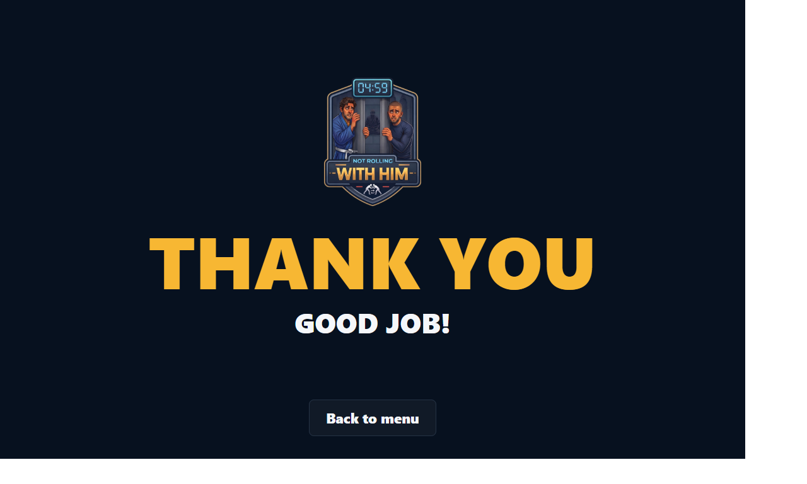
</p>

## Tech stack and repository layout

| Layer | Implementation |
|---|---|
| Runtime and UI | [Expo SDK 58](https://expo.dev/) and React Native 0.88.1 (React 19.3.1) |
| Language | TypeScript 6.0 |
| Navigation | Expo Router |
| Local storage | `@react-native-async-storage/async-storage` 3.1 |
| Audio engine | `expo-audio` (configured without microphone permissions) |
| Mobile builds | EAS Build (Android AAB and APK) |
| Web hosting | Static Metro export deployed over FTPS to self-hosted Apache |
| Target devices | 10.5-inch Android wall tablets, Android and iOS phones, desktop and mobile browsers |

Key files in the repository:

```
app/
  _layout.tsx                  # Root navigation shell and screen wake-lock setup
  (tabs)/
    index.tsx                  # Setup screen, live timers, pair grids, and modals
    i18n.ts                    # PL, EN, and PT translation dictionary
    types.ts                   # Athlete, match, and sparring option types
    engine/
      matchmaker.ts            # Bitmask DP and beam-search matchmaking solver
constants/
  training-helpers.ts          # Input validation, storage sanitizers, and triad builder
hooks/
  use-safe-keep-awake.ts       # Safe WakeLock wrapper across native and web tabs
tests/
  engine-and-helpers.test.mjs  # Unit tests for matchmaking and training helpers
public/
  .htaccess                    # Apache SPA routing and cache headers
  privacy/index.html           # Standalone PL, EN, and PT privacy policy page
scripts/
  deploy-web.mjs               # FTPS deployment script with selective remote backup
plugins/
  with-adi-registration.js     # Expo config plugin bundling Google Play ADI verification
```

## Local development and release builds

Install dependencies with `npm` and run the development server, unit test suite, linter, or TypeScript compiler:

```bash
npm install
npx expo start

npm test
npm run lint
npx tsc --noEmit
```

Run `npx expo export --platform web` to generate the static web bundle into `dist/`, or `npm run release:web` to export and upload via FTPS using `.secrets/ftp.json`. For Google Play production builds and automatic submission, run `npm run release:android` as documented in [docs/play-store/build-and-submit.md](docs/play-store/build-and-submit.md).

## Web app and privacy

You can run the full timer in any desktop, tablet, or phone browser without installing anything at [https://znimnierobie.pl](https://znimnierobie.pl).

The app requires no sign-up, sends zero data off your device, and includes no analytics SDKs or ad trackers. Read the full notice in [docs/privacy-policy.md](docs/privacy-policy.md) or at [https://znimnierobie.pl/privacy](https://znimnierobie.pl/privacy), and check [CHANGELOG.en.md](CHANGELOG.en.md) for full release notes.

## License

All rights reserved. Source code is published in this repository for review purposes only.

<p align="center">
  <b>Z NIM NIE ROBIĘ</b> · v2.3 · Mat timer and pair matchmaker for BJJ
</p>

