# Z NIM NIE ROBIĘ

<p align="center">
  
</p>

<p align="center">
  <b>Timer i automatyczny dobór par na treningi BJJ, grapplingu oraz zadaniówek.</b><br/>
  Sparingi bez powtórek · Duży zegar czytelny z końca maty · Rotacja w trójkach i drille
</p>

<p align="center">
  
  
  
  
  
</p>

<p align="center">
  <a href="https://znimnierobie.pl"><b>Otwórz wersję w przeglądarce (znimnierobie.pl)</b></a>
</p>

<p align="center">
  <a href="https://play.google.com/store/apps/details?id=pl.znimnierobie.app">
    
  </a>
</p>

<p align="center">
  <b>Polski</b> · <a href="README.en.md">English</a> · <a href="README.pt-BR.md">Português (BR)</a>
</p>

## Co rozwiązuje ta aplikacja na sali

Przy kilkunastu albo czterdziestu osobach na macie ręczne rozstawianie par co rundę zjada przerwę, kończy się ciągłym wpadaniem tych samych kolegów na siebie i zostawia pod ścianą osoby bez pary. Kartka i zwykły stoper na ścianie załatwiają tylko odliczanie czasu.

**Z NIM NIE ROBIĘ** spina zegar rundowy z algorytmem dobierającym składy na tablet ustawiony przy macie lub powieszony na ścianie. Przed zajęciami zaznaczasz z bazy klubowej kto przyszedł na trening, wybierasz czas pracy oraz przerw i puszczasz start. Program sam pilnuje gongów, układa pary według wagi, stażu, stroju i płci, pokazuje następne zestawienia już w trakcie odpoczynku i pamięta historię całej sesji, żeby nikt nie robił dwa razy z tą samą osobą przed zamknięciem kolejki.

Całość działa po polsku, angielsku i brazylijskim portugalsku. Nie wymaga zakładania konta ani dostępu do Wi-Fi na sali, bo cała baza zawodników zapisuje się lokalnie w pamięci urządzenia.

## Co zmieniło się w ostatnich wydaniach

### Wydanie 2.3 i migracja na Expo SDK 58

W wersji 2.3 cały stos uruchomieniowy przeszedł na Expo SDK 58, React Native 0.88.1, React 19.3.1, AsyncStorage 3.1.1 oraz TypeScript 6.0.3. Przestarzały moduł dźwiękowy zastąpiliśmy biblioteką `expo-audio` skonfigurowaną bez uprawnienia do mikrofonu, zachowując sygnał gongu, podwójne klaśnięcie na 10 sekund przed końcem rundy i automatyczne ściszanie muzyki grającej w tle. Odświeżyliśmy przy tym komunikaty walidacji, opisy opcji oraz wielojęzyczną stronę polityki prywatności.

### Szybszy solver i poprawki logiki w wersji 2.2

Silnik parowania przepisaliśmy na programowanie dynamiczne na maskach bitowych i tablicach indeksowanych. Dokładny solver ogarnia teraz grupy do 12 osób zamiast wcześniejszych 10, a wyliczenie rundy dla pełnej sali na 46 osób trwa około 13 razy krócej. Sam zegar liczy czas względem zegara systemowego, więc nie gubi sekund na długich rundach ani po przełączeniu karty w przeglądarce.

W tej samej aktualizacji poprawiliśmy priorytet walk kobiecych tak, aby kolejki liczyły się osobno dla dzieci i dorosłych, współgrały z podziałem wagowym i omijały osoby wpisane na listę bez pauzy. Pary mieszane dzieci z dorosłymi pojawiły się na siatce w zadaniówkach dwójkowych oraz w drillach, a pojedynczy dorosły na treningu dziecięcym w trójkach zawsze trafia do grupy. W bazie klubowej doszło trwałe kasowanie starych wpisów, anulowanie edycji, wpisywanie wagi z przecinkiem (np. `82,5` w przedziale od 10 do 300 kg), skróty klawiaturowe w przeglądarce oraz pionowy układ podziału wagowego na wąskich ekranach telefonów.

### Lokalizacja, goście z innych klubów i publikacja w Google Play (2.0 do 2.1)

W cyklu wydań 2.0 oraz 2.1 aplikacja przeszła przegląd Google Play i dostała komplet tłumaczeń na angielski oraz portugalski na wszystkich ekranach zegara. Pojawił się przełącznik `GOŚĆ` dla osób wpadających na otwartą matę z innego klubu, dzięki któremu przyjezdni trafiają na gospodarzy zamiast sparować między sobą.

Siatkę przygotowania połączyliśmy we wspólny widok z kolorami kategorii (`KID GI`, `KID NO-GI`, `ADULT GI`, `ADULT NO-GI` oraz pary mieszane), a listę odpoczywających przenieśliśmy do górnego paska widocznego również w czasie przerwy. W oknie wypisywania zawodnika w trakcie rundy rozdzieliliśmy stałe zejście z maty od odpoczynku na jedną rundę, a blokadę wygaszania ekranu przypięliśmy na poziomie głównego układu aplikacji.

## Tryby pracy na macie

### Klasyczne sparingi

Każda runda przechodzi przez przygotowanie z podglądem rozpisanych par, właściwą walkę z dużym zegarem na pełnym ekranie oraz przerwę, na której od razu widać układ par wyliczony na następną kolejkę. Trener może wcześniej rzucić okiem na zestawienia i skorygować grupę, zanim zabrzmi gong.

W panelu sparingów ustawisz suwak ważący między stażem a wagą w czterech krokach, kolejność walk (od najbardziej wyrównanych, od zróżnicowanych albo losowo) oraz tryb walk kobiecych. Przy dużej grupie na małej macie przydaje się podział wagowy, który tnie salę na lżejszą i cięższą połowę walczące na zmianę z dwudziestosekundowym oknem na zejście i wejście.

### Zadaniówki w trójkach

Program dzieli salę na trzyosobowe składy i rozbija rundę na sześć równych etapów. W każdym etapie dwie osoby pracują w zadaniu z podziałem na dół i górę, a trzecia łapie oddech lub pilnuje przestrzeni obok.

| Etap | [A] DÓŁ | [B] GÓRA | [C] PAUZA |
|:----:|:-------:|:--------:|:---------:|
| 1 | Osoba 1 | Osoba 2 | Osoba 3 |
| 2 | Osoba 1 | Osoba 3 | Osoba 2 |
| 3 | Osoba 2 | Osoba 1 | Osoba 3 |
| 4 | Osoba 2 | Osoba 3 | Osoba 1 |
| 5 | Osoba 3 | Osoba 1 | Osoba 2 |
| 6 | Osoba 3 | Osoba 2 | Osoba 1 |

Po sześciu zmianach każdy w trójce przerobił sytuację z każdym z obu pozycji. Czas pojedynczego etapu wylicza się sam jako długość rundy podzielona przez sześć.

### Zadaniówki w dwójkach

Pary dobierają się tak samo jak do sparingu, ale każda runda dzieli się na dwie połowy. Po sygnale w środku rundy osoba pracująca z dołu zamienia się miejscem z górą bez szukania nowego partnera.

### Drille techniczne

W trybie drilli silnik dobiera pary tylko raz na początku treningu i trzyma te same dwójki do ostatniego gongu, zamieniając co rundę rolę ćwiczącego i asystującego. Sprawdza się przy nauce nowej sekwencji technicznej, kiedy ciągła zmiana partnera o innej budowie ciała tylko wybija z rytmu.

## Jak silnik dobiera pary

Algorytm nie rzuca monetą. Buduje graf dopuszczalnych zestawień i szuka podziału o najniższym koszcie według twardej hierarchii kryteriów. Do dwunastu osób w grupie sprawdza wszystkie kombinacje programowaniem dynamicznym na maskach bitowych, a przy większej sali przechodzi na przeszukiwanie wiązkowe.

| Kolejność | Brane pod uwagę kryterium |
|:---------:|---------------------------|
| 1 | Unikanie powtórek na podstawie historii stoczonych już rund w danej sesji |
| 2 | Rozdzielenie gości z innych klubów, żeby przyjezdni walczyli z klubowiczami |
| 3 | Zgodność stroju (`GI` z `GI`, `NO-GI` z `NO-GI`, a przy parze mieszanej całość traktowana jako `NO-GI`) |
| 4 | Wybrany wariant walk kobiecych (brak podziału, najpierw pełna kolejka kobieca albo ścisłe rozdzielenie) |
| 5 | Zbliżony poziom zaawansowania (`POCZ.`, `ŚR.ZAAW.`, `ZAAW.`, `PRO`) |
| 6 | Jak najmniejsza różnica masy ciała między partnerami |
| 7 | Równa kolejka przymusowych pauz przy nieparzystej liczbie osób z pominięciem listy `BEZ PAUZY (VIP)` |

Dzieci i dorośli liczą się w osobnych pulach. Pojedyncze dziecko i dorosły łączą się w parę mieszaną tylko wtedy, gdy obie grupy są nieparzyste i bez takiego ruchu dwie osoby naraz siedziałyby pod ścianą. Gdy przy bardzo długim treningu każdy zdążył już zawalczyć z każdym, solver wybiera dwójkę, która miała ze sobą najdłuższą przerwę od poprzedniego starcia.

## Przegląd ekranów aplikacji

### Wybór języka przy pierwszym starcie

Przy pierwszym uruchomieniu wybierasz polski, angielski lub portugalski. Później język zmienisz jednym dotknięciem na dolnym pasku ekranu ustawień.

<p align="center">
  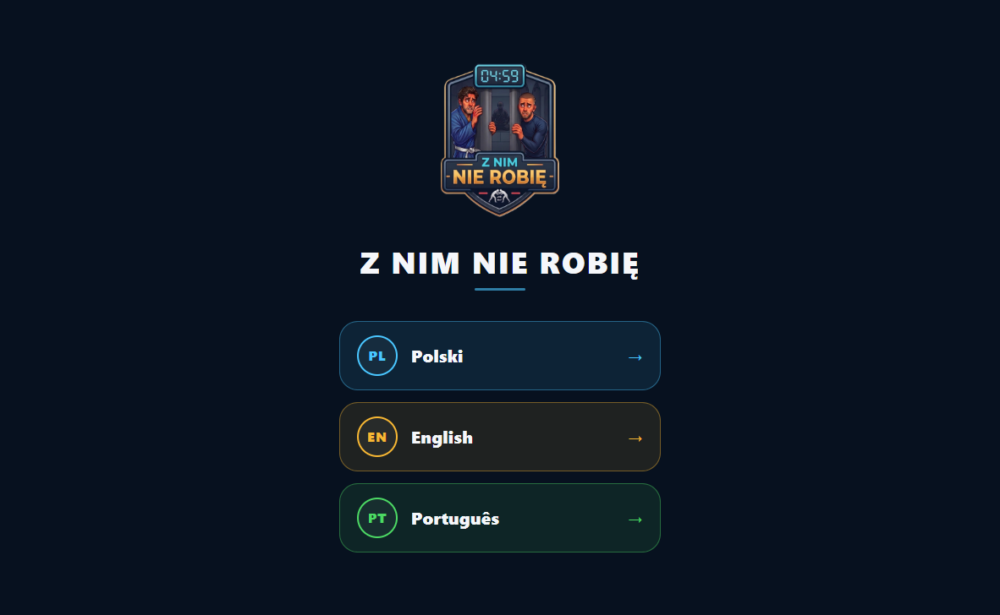
</p>

### Pusty ekran ustawień przed treningiem

Po lewej stronie ustawiasz skład, czasy rund i opcje wybranego trybu, a prawa część ekranu czeka na kafelki obecnych dziś zawodników.

<p align="center">
  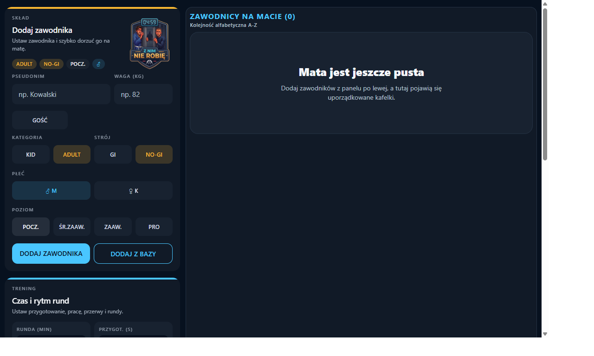
</p>

### Karta dodawania i edycji zawodnika

W formularzu wpisujesz pseudonim i wagę, zaznaczasz kategorię wiekową, strój, płeć, staż oraz ewentualny status gościa. Kliknięcie gotowego kafelka na macie ładuje dane tej osoby z powrotem do edycji.

<p align="center">
  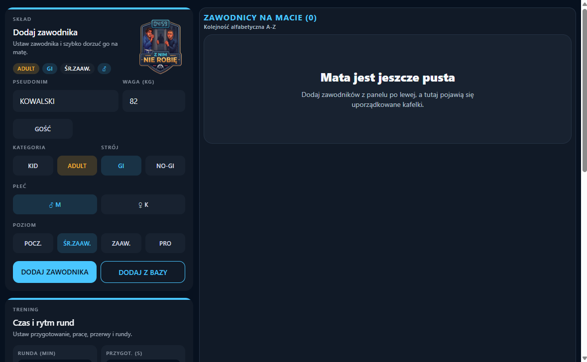
</p>

### Wyszukiwarka w bazie klubowej

Raz wpisani klubowicze zostają w pamięci urządzenia. W oknie bazy klubowej odfiltrujesz listę po literach pseudonimu albo usuniesz stare wpisy ikoną kosza.

<p align="center">
  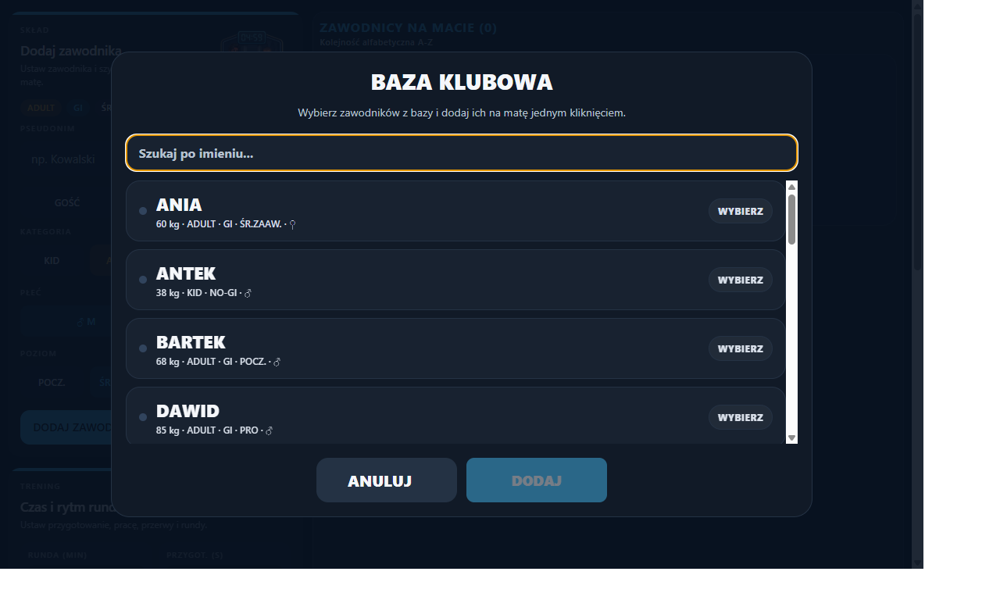
</p>

### Hurtowe dorzucanie obecnych na matę

Przed zajęciami odklikujesz na liście kilkanaście osób naraz i wrzucasz cały skład na matę jednym przyciskiem na dole okna.

<p align="center">
  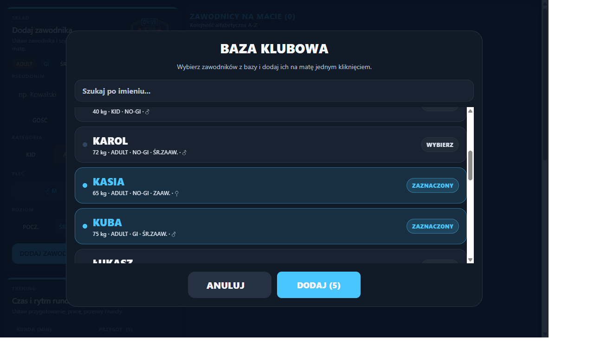
</p>

### Skład ułożony alfabetycznie z filtrami

Kafelki na macie układają się od A do Z i pokazują komplet oznaczeń. Pasek filtrów nad siatką pozwala jednym dotknięciem podejrzeć samych dorosłych, grupę dziecięcą albo osoby w kimonach.

<p align="center">
  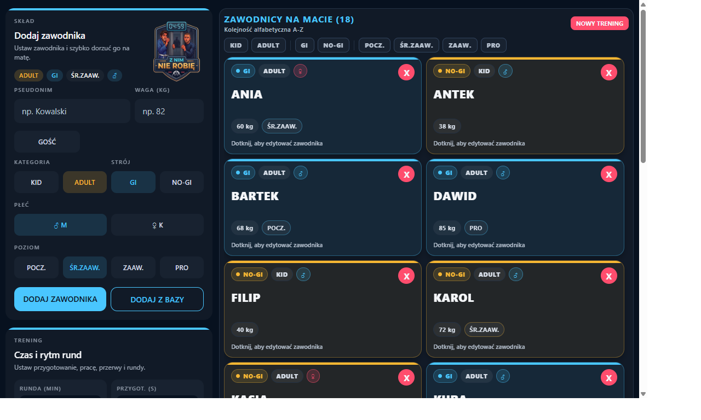
</p>

### Ustawienia sparingów

Panel opcji sparingowych z listą zawodników bez pauzy, suwakiem wagi kryteriów, kolejnością walk, podziałem wagowym i ustawieniem walk kobiecych.

<p align="center">
  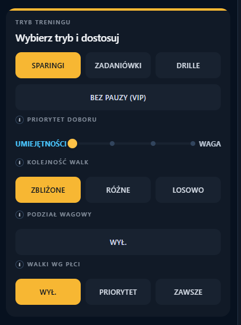
</p>

### Przełącznik zadaniówek na trójki i dwójki

Po przełączeniu trybu na zadaniówki wybierasz pracę w grupach trzyosobowych albo w parach ze zmianą roli w połowie czasu.

<p align="center">
  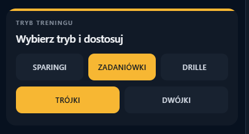
</p>

### Ustawienie trybu drilli

Krótki widok startowy dla pracy technicznej w stałych parach przez wszystkie zaplanowane rundy.

<p align="center">
  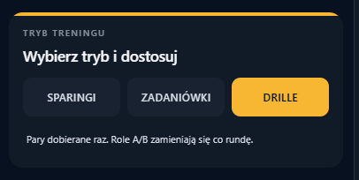
</p>

### Faza przygotowania przed sparingiem

Siatka dobranych par przed pierwszą rundą z kolorami kategorii i odliczaniem czasu na podejście do partnera.

<p align="center">
  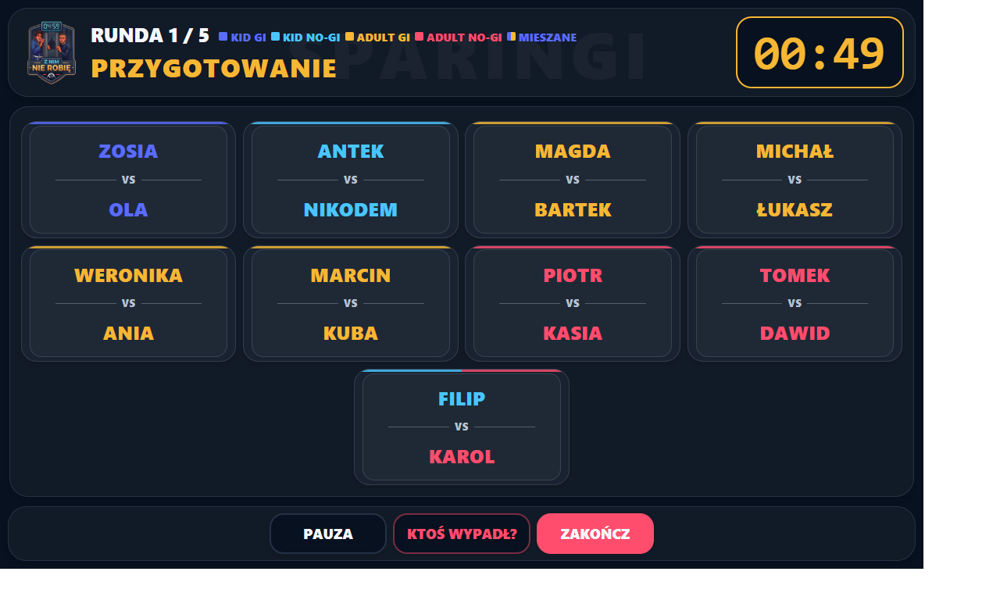
</p>

### Zegar walki w trakcie sparingu

Pełnoekranowe cyfry widoczne z drugiego końca sali wraz z numerem rundy oraz przyciskami pauzy, korekty składu i zakończenia zajęć.

<p align="center">
  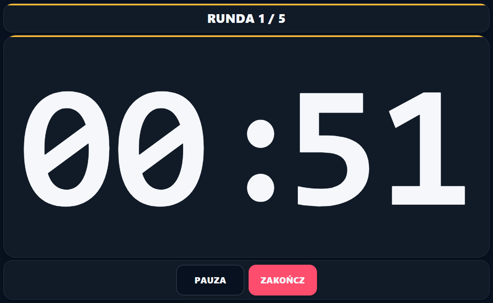
</p>

### Przerwa z rozpiską kolejnej rundy

Od razu po gongu kończącym walkę na ekranie wskakują nowe pary na następną rundę oraz lista osób łapiących oddech.

<p align="center">
  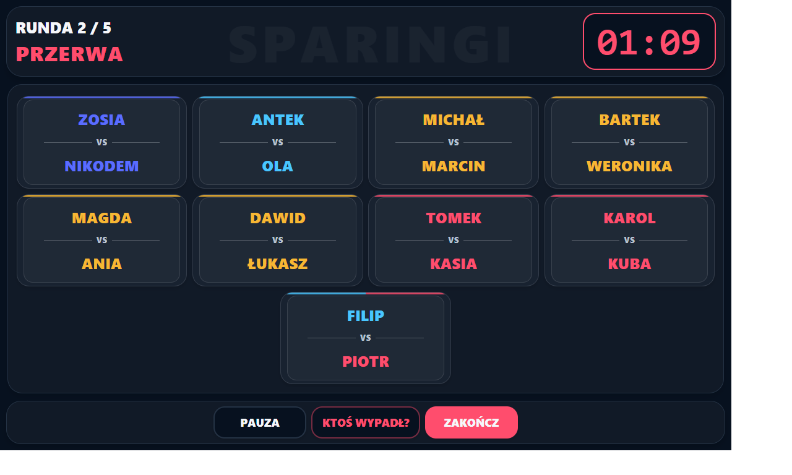
</p>

### Rozstawienie trójek przed zadaniówką

Karty trzyosobowych grup z rozpisanym podziałem na dół, górę oraz osobę czekającą na wejście.

<p align="center">
  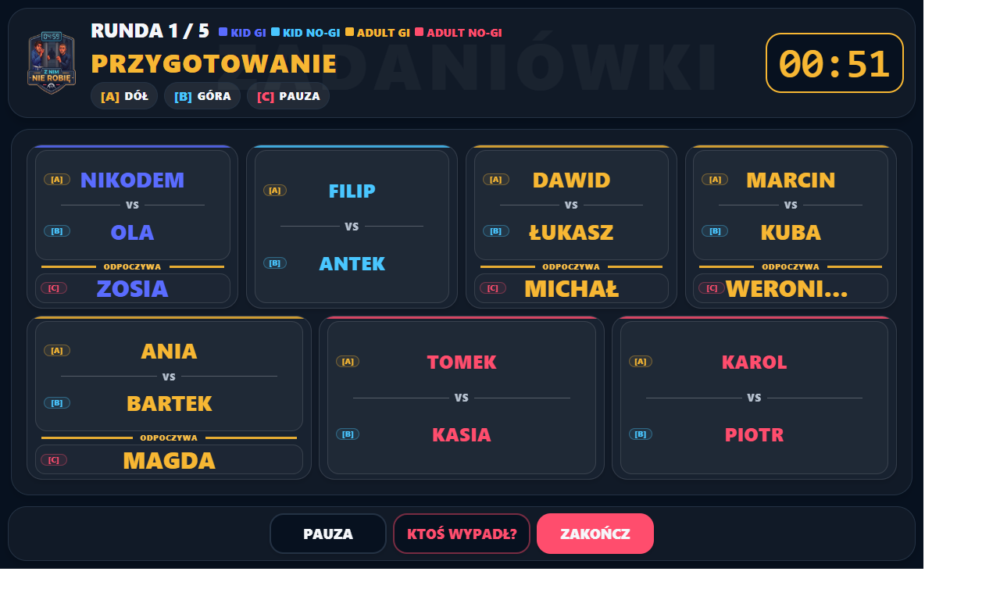
</p>

### Odliczanie etapu i podpowiedź zmiany w trójkach

Zegar pojedynczego etapu pokazuje kto pracuje teraz i kto wchodzi na matę po najbliższym sygnale.

<p align="center">
  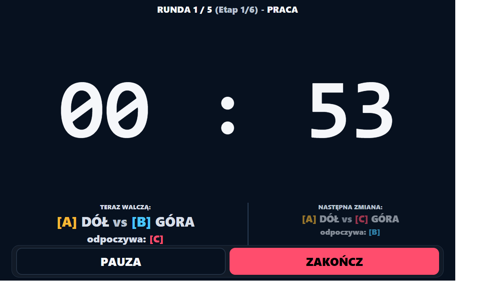
</p>

### Przygotowanie do zadaniówek w dwójkach

Widok par z przypisanymi stronami A oraz B przed pierwszym gwizdkiem rundy.

<p align="center">
  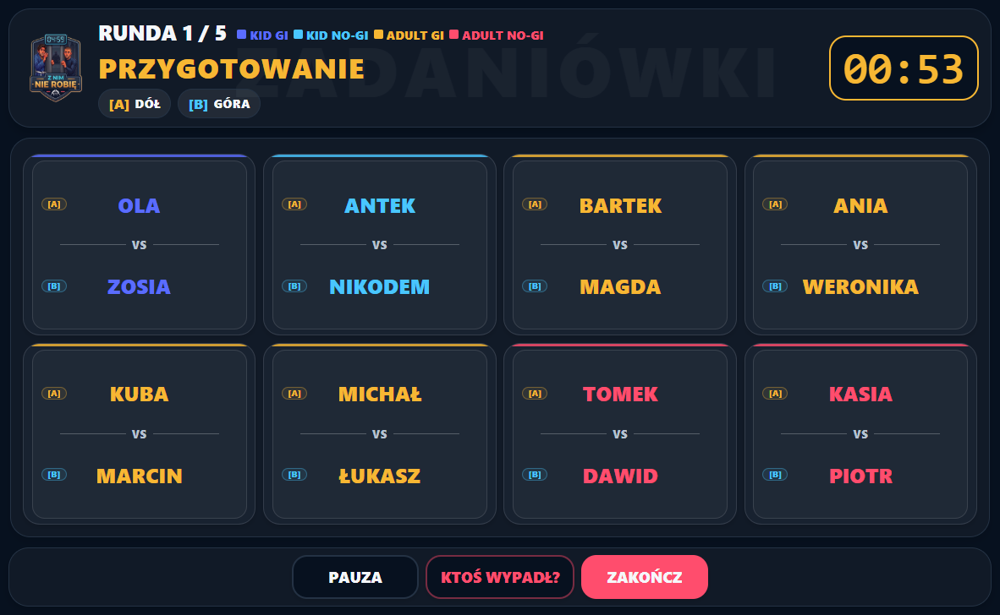
</p>

### Zegar zadaniówek w dwójkach

Odliczanie pierwszego etapu pracy w parze z zapowiedzią zamiany ról w połowie rundy.

<p align="center">
  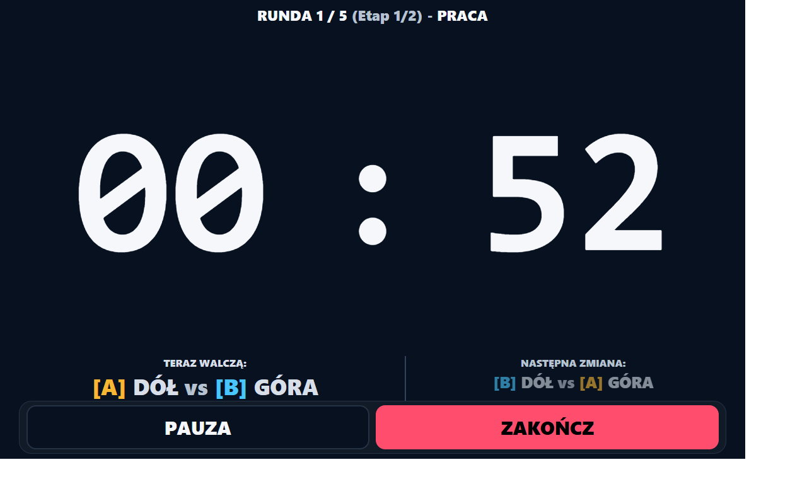
</p>

### Wypisanie zawodnika w trakcie treningu

Gdy ktoś złapie uraz albo musi odejść do telefonu, zatrzymujesz czas i jednym oknem zdejmujesz go do końca treningu lub na jedną kolejkę. Pary przeliczają się od ręki bez zerowania zegara sesji.

<p align="center">
  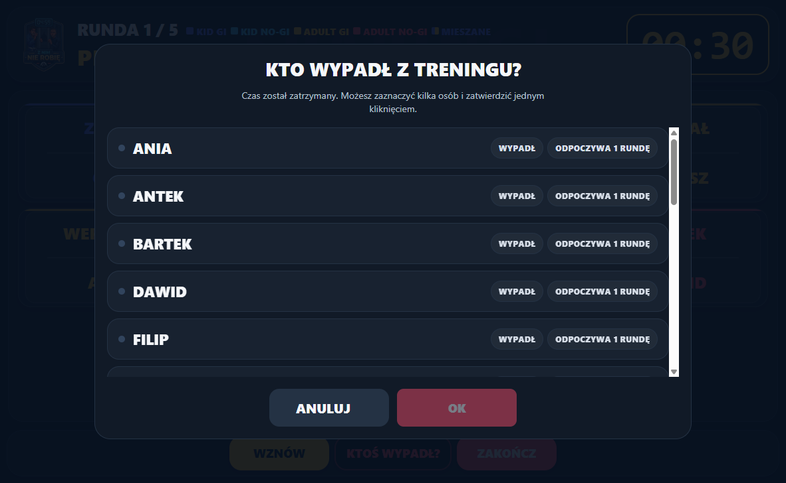
</p>

### Wybór osób trenujących bez pauzy

Okno z pigułkami imion, w którym oznaczasz trenera lub zawodników przygotowujących się pod zawody, żeby algorytm omijał ich przy rozdzielaniu wolnego losu.

<p align="center">
  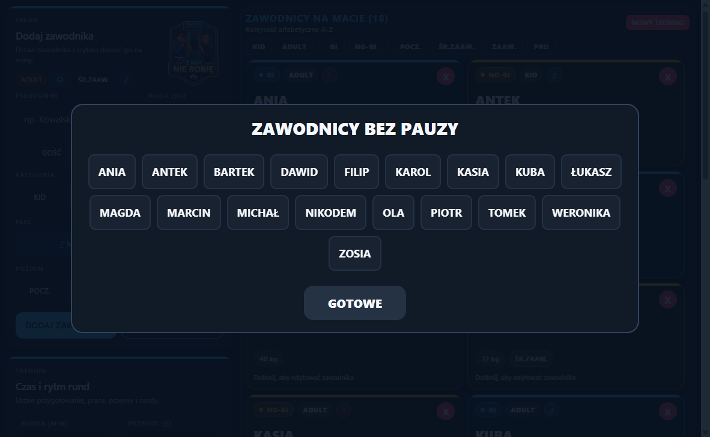
</p>

### Karta informacyjna aplikacji

Okno z numerem wersji, kontaktem mailowym, odnośnikiem do repozytorium na GitHubie oraz sklepu mantoshop.pl.

<p align="center">
  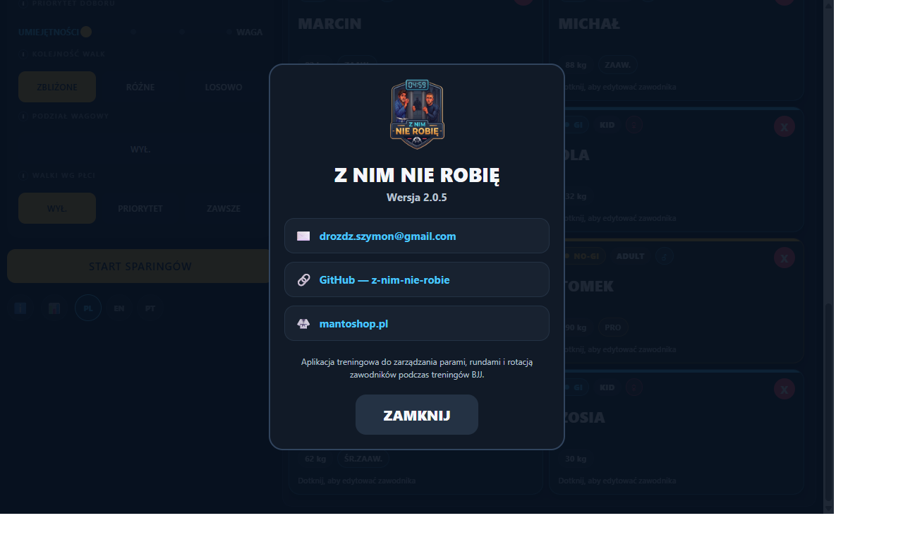
</p>

### Ekran po ostatnim gongu

Podsumowanie zamkniętej sesji i powrót jednym przyciskiem do ekranu ustawień.

<p align="center">
  
</p>

## Wykorzystane technologie i układ katalogów

| Warstwa | Rozwiązanie w projekcie |
|---|---|
| Środowisko i UI | [Expo SDK 58](https://expo.dev/) oraz React Native 0.88.1 (React 19.3.1) |
| Język i kontrola typów | TypeScript 6.0 |
| Nawigacja | Expo Router |
| Pamięć lokalna | `@react-native-async-storage/async-storage` 3.1 |
| Obsługa dźwięku | `expo-audio` (bez uprawnień do mikrofonu) |
| Budowanie paczek mobilnych | EAS Build (Android AAB i APK) |
| Wersja WWW | Eksport statyczny Metro i publikacja przez FTPS na własnym serwerze |
| Docelowe urządzenia | Tablety z Androidem około 10,5 cala, telefony Android i iOS oraz przeglądarki |

Układ najważniejszych plików w repozytorium wygląda następująco:

```
app/
  _layout.tsx                  # Główny układ nawigacji i blokada wygaszania ekranu
  (tabs)/
    index.tsx                  # Widoki ustawień, zegarów, siatek par i okien modalnych
    i18n.ts                    # Słownik tłumaczeń PL, EN i PT
    types.ts                   # Typy domenowe zawodników, par i opcji sparingowych
    engine/
      matchmaker.ts            # Solver doboru par (maski bitowe + przeszukiwanie wiązkowe)
constants/
  training-helpers.ts          # Walidacja formularzy, sanityzacja bazy i składanie trójek
hooks/
  use-safe-keep-awake.ts       # Obsługa WakeLock na urządzeniach mobilnych i w przeglądarce
tests/
  engine-and-helpers.test.mjs  # Testy jednostkowe silnika parowania i funkcji pomocniczych
public/
  .htaccess                    # Reguły routingu SPA i nagłówków pamięci podręcznej Apache
  privacy/index.html           # Statyczna strona polityki prywatności w trzech językach
scripts/
  deploy-web.mjs               # Skrypt publikacji wersji WWW przez FTPS z kopią zapasową
plugins/
  with-adi-registration.js     # Wtyczka Expo kopiująca plik weryfikacyjny Google Play
```

## Uruchomienie lokalne i budowanie wydań

Do pracy nad kodem wystarczy Node.js oraz `npm`. Po pobraniu repozytorium zainstaluj pakiety i uruchom serwer deweloperski albo zestaw testów:

```bash
npm install
npx expo start

npm test
npm run lint
npx tsc --noEmit
```

Gotową wersję przeglądarkową wygenerujesz do katalogu `dist/` poleceniem `npx expo export --platform web`, a przy skonfigurowanym pliku `.secrets/ftp.json` wgrasz ją od razu na serwer komendą `npm run release:web`. Paczkę produkcyjną `.aab` z automatyczną wysyłką do Google Play uruchamia skrypt `npm run release:android` opisany szerzej w pliku [docs/play-store/build-and-submit.md](docs/play-store/build-and-submit.md).

## Wersja przeglądarkowa i prywatność

Z aplikacji można korzystać bez instalacji prosto w przeglądarce na laptopie, tablecie lub telefonie pod adresem [https://znimnierobie.pl](https://znimnierobie.pl).

Program nie zbiera żadnych danych o użytkownikach, nie wymaga logowania, nie wysyła składu klubu przez sieć i nie ładuje skryptów analitycznych ani reklamowych. Pełną treść dokumentu znajdziesz w pliku [docs/privacy-policy.md](docs/privacy-policy.md) oraz pod adresem [https://znimnierobie.pl/privacy](https://znimnierobie.pl/privacy), a zapis zmian między wydaniami w pliku [CHANGELOG.md](CHANGELOG.md).

## Licencja

Wszelkie prawa zastrzeżone. Kod źródłowy udostępniono w repozytorium wyłącznie do wglądu.

<p align="center">
  <b>Z NIM NIE ROBIĘ</b> · v2.3 · Timer i dobór par na matę
</p>

