# Z NIM NIE ROBIĘ

<p align="center">
  
</p>

<p align="center">
  <b>Cronômetro de tatame e montagem automática de duplas para sparring, treinos posicionais e drills de BJJ.</b><br/>
  Rolas sem repetição · Relógio grande visível de longe · Rodízio em trios e drills fixos
</p>

<p align="center">
  
  
  
  
  
</p>

<p align="center">
  <a href="https://znimnierobie.pl"><b>Abrir a versão no navegador (znimnierobie.pl)</b></a>
</p>

<p align="center">
  <a href="https://play.google.com/store/apps/details?id=pl.znimnierobie.app">
    
  </a>
</p>

<p align="center">
  <a href="README.md">Polski</a> · <a href="README.en.md">English</a> · <b>Português (BR)</b>
</p>

## O que o aplicativo resolve no tatame

Em turmas com vinte ou quarenta pessoas, casar duplas no grito a cada intervalo come o tempo de descanso, repete sempre os mesmos parceiros e deixa gente sobrando encostada na parede. Um cronômetro comum de academia só marca o tempo.

O **Z NIM NIE ROBIĘ** ("Não rolo com ele") junta o relógio de parede e a montagem das chaves em um único tablet apoiado no banco ou preso na parede. Antes da aula começar, você marca no banco do clube quem pisou no tatame hoje, escolhe os tempos de luta e descanso e aperta iniciar. O aplicativo toca o gongo, monta as duplas por peso, nível técnico, traje com ou sem kimono e gênero, já adianta na tela de intervalo quem vai rolar na próxima e guarda todo o histórico da sessão para ninguém repetir parceiro antes de fechar o rodízio.

Tudo roda offline em polonês, inglês e português do Brasil, sem criar conta e sem depender de Wi-Fi na academia. Os cadastros ficam salvos apenas na memória do seu próprio aparelho.

## Novidades das últimas versões

### Versão 2.3 e migração para o Expo SDK 58

Na versão 2.3 toda a base do aplicativo foi atualizada para Expo SDK 58, React Native 0.88.1, React 19.3.1, AsyncStorage 3.1.1 e TypeScript 6.0.3. Trocamos o antigo pacote `expo-av` pela biblioteca `expo-audio` configurada sem permissão de microfone, preservando o gongo, o aviso duplo faltando 10 segundos e a redução automática da música de fundo. Também revisamos as mensagens do formulário, as dicas das opções e a página de privacidade nos três idiomas.

### Solver mais rápido e ajustes de lógica na versão 2.2

Reescrevemos o motor de pareamento com programação dinâmica em bitmask e tabelas indexadas. O cálculo exato agora atende grupos de até 12 pessoas (antes 10) e turmas cheias com 46 alunos rodam cerca de 13 vezes mais rápido. A contagem regressiva passou a ler direto o relógio do sistema para não atrasar em rodadas longas nem com o navegador em segundo plano.

Na mesma entrega separamos o controle de rodízio feminino entre `KID` e `ADULT`, integramos essa regra com a divisão de peso e com `SEM DESCANSO (VIP)` e corrigimos a exibição de duplas mistas no treino posicional em duplas e nos drills, além do encaixe de um adulto único treinando com crianças nos trios. O Banco do Clube ganhou exclusão permanente pelo ícone de lixeira, botão para cancelar edição, peso com vírgula decimal como `82,5` entre 10 e 300 kg, atalhos de teclado na web e layout vertical para celulares de 360 px.

### Idiomas completos, atletas visitantes e publicação no Google Play (2.0 a 2.1)

Entre as versões 2.0 e 2.1 o aplicativo entrou no Google Play e recebeu tradução completa em todas as telas do cronômetro. O cadastro do lutador ganhou a chave `VISITANTE` com ícone roxo de avião para evitar que dois visitantes de outra equipe caiam juntos quando há alunos da casa disponíveis.

Unificamos a tela de preparação em uma grade colorida por categoria (`KID GI`, `KID NO-GI`, `ADULT GI`, `ADULT NO-GI` e `MISTO`), mantivemos os nomes em descanso visíveis no topo também durante o intervalo, criamos duas opções de saída no meio do treino (sair de vez ou descansar uma rodada) e fixamos o bloqueio de tela na raiz do aplicativo para o tablet nunca apagar.

## Modos de aula no tatame

### Sparring tradicional

Cada rodada passa pela preparação com os cartões das duplas na tela, pelo cronômetro cheio durante o rola e pelo intervalo já exibindo a formação calculada para a rodada seguinte. O professor consegue conferir as chaves e orientar a turma antes do gongo bater.

No painel de opções você ajusta o controle deslizante entre técnica e peso em quatro níveis, escolhe a ordem das lutas (`PAREADO`, `VARIADO` ou `ALEATÓRIO`) e define o filtro feminino. Quando o tatame aperta, a divisão de peso separa a turma em grupo leve e grupo pesado revezando na área de luta com 20 segundos de transição.

### Treino posicional em trios

O aplicativo monta grupos de três atletas e divide cada rodada em seis etapas iguais. Dois trabalham embaixo e em cima enquanto o terceiro descansa ou acompanha de perto.

| Etapa | [A] BAIXO | [B] CIMA | [C] DESCANSO |
|:-----:|:---------:|:--------:|:------------:|
| 1     | Pessoa 1  | Pessoa 2 | Pessoa 3     |
| 2     | Pessoa 1  | Pessoa 3 | Pessoa 2     |
| 3     | Pessoa 2  | Pessoa 1 | Pessoa 3     |
| 4     | Pessoa 2  | Pessoa 3 | Pessoa 1     |
| 5     | Pessoa 3  | Pessoa 1 | Pessoa 2     |
| 6     | Pessoa 3  | Pessoa 2 | Pessoa 1     |

Ao fim das seis trocas todos passaram pelas duas posições contra os dois colegas do trio. O tempo de cada etapa equivale a um sexto do tempo configurado para a rodada.

### Treino posicional em duplas

As duplas são montadas pelo algoritmo da mesma forma que no sparring, mas cada rodada é cortada ao meio para inverter quem faz guarda e quem passa sem trocar de parceiro.

### Drills técnicos

No modo de drills as duplas são definidas uma única vez no início da aula e seguem juntas até o fim, trocando os lados A e B a cada rodada para manter o ritmo de repetição da posição.

## Prioridades do motor de montagem de duplas

Em vez de sortear nomes, o solver pontua cada combinação seguindo uma ordem rígida de regras. Turmas de até 12 atletas usam programação dinâmica exata em bitmask e grupos maiores usam busca em feixe indexada.

| Ordem | Regra aplicada pelo algoritmo |
|:-----:|-------------------------------|
| 1 | Priorizar duplas inéditas consultando todo o histórico da aula |
| 2 | Separar atletas marcados como `VISITANTE` para que rolem com alunos da casa |
| 3 | Casar `GI` com `GI` e `NO-GI` com `NO-GI` (par misto conta como `NO-GI`) |
| 4 | Respeitar a regra escolhida para lutas femininas (`DESL.`, `PRIORIDADE` ou `SEMPRE`) |
| 5 | Aproximar o nível técnico (`INIC.`, `INTERM.`, `AVANÇ.`, `PRO`) |
| 6 | Reduzir a diferença de peso entre os dois parceiros |
| 7 | Revezar de forma justa quem sobra em número ímpar poupando a lista `SEM DESCANSO (VIP)` |

Crianças e adultos rodam em chaves separadas e só formam dupla mista quando os dois grupos ficam ímpares ao mesmo tempo. Se o treino tiver mais rodadas do que combinações possíveis, o motor escolhe a dupla que se enfrentou há mais tempo.

## Telas do aplicativo

### Escolha do idioma na primeira abertura

Selecione polonês, inglês ou português logo ao abrir o app ou troque o idioma a qualquer momento pela barra inferior.

<p align="center">
  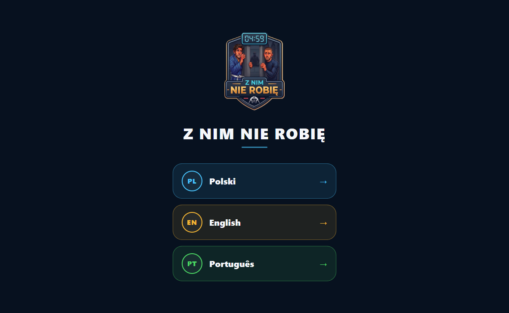
</p>

### Tela inicial com tatame vazio

Cadastre atletas, ajuste os tempos e escolha o modo de treino na coluna esquerda enquanto a direita aguarda o elenco da aula.

<p align="center">
  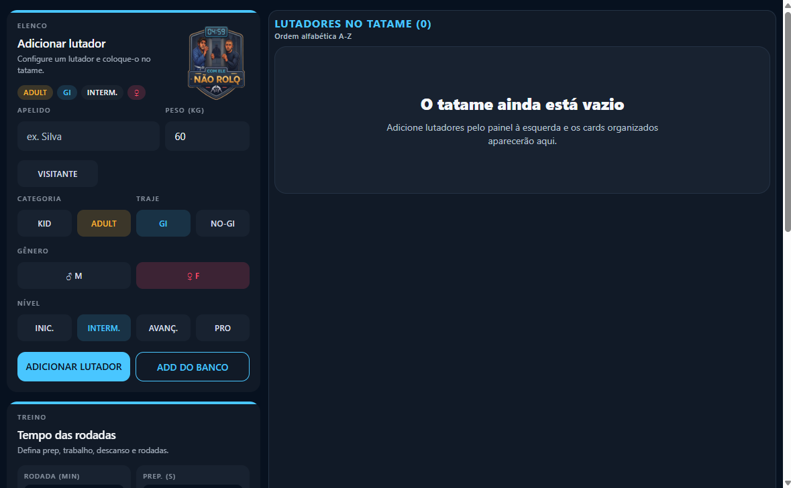
</p>

### Cadastro e edição da ficha do atleta

Preencha apelido e peso e marque faixa etária, traje, gênero, nível técnico e status de visitante. Tocar em qualquer cartão do tatame reabre os dados para edição rápida.

<p align="center">
  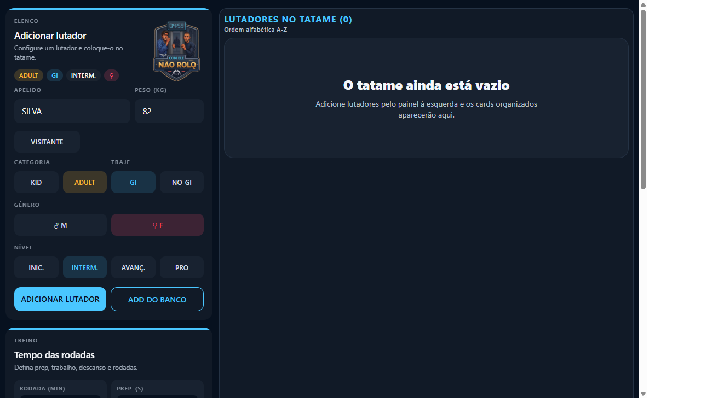
</p>

### Busca rápida no banco do clube

Os alunos cadastrados ficam gravados no aparelho para as próximas aulas, com filtro por apelido e exclusão definitiva no ícone de lixeira.

<p align="center">
  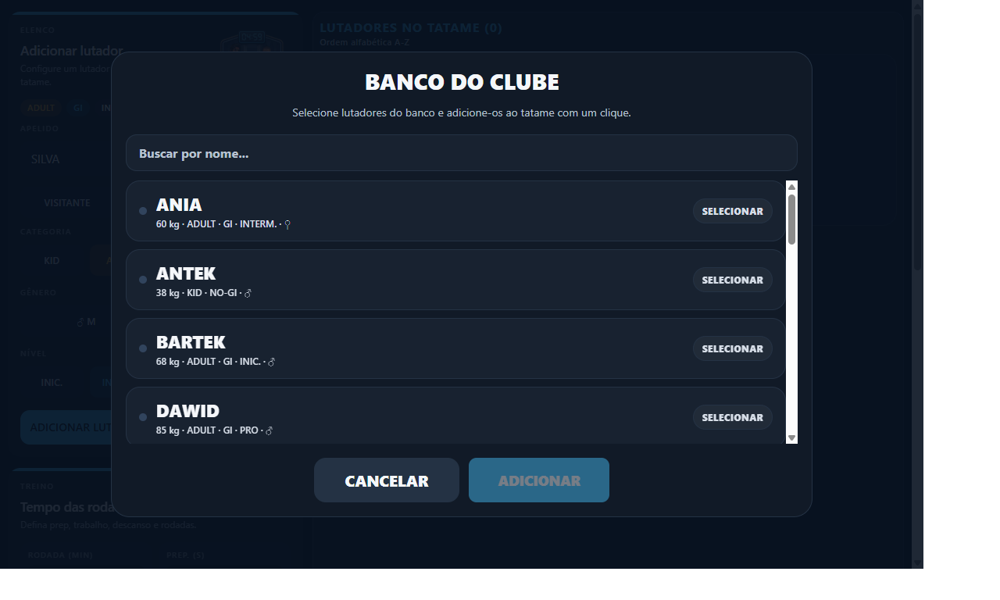
</p>

### Adição da turma inteira de uma vez

Marque vários nomes no banco do clube e coloque todos no tatame com um único toque.

<p align="center">
  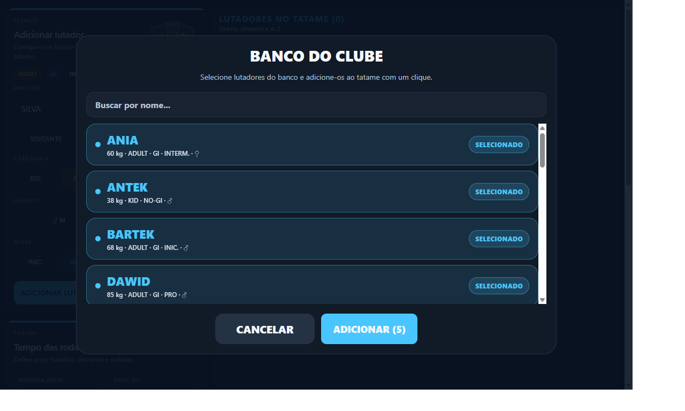
</p>

### Elenco em ordem alfabética com filtros

Cartões organizados de A a Z com filtros rápidos no topo por categoria, kimono e graduação.

<p align="center">
  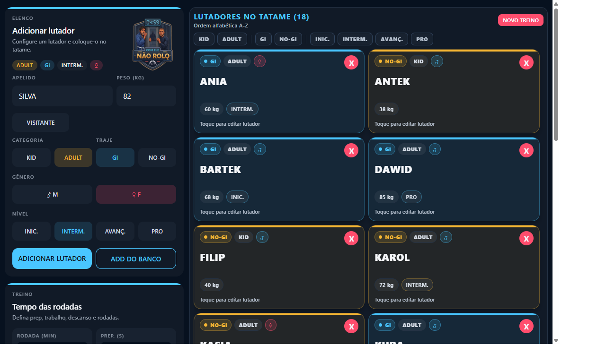
</p>

### Opções do modo sparring

Ajuste de atletas sem descanso, controle entre habilidade e peso, ordem das lutas, divisão de peso e lutas femininas.

<p align="center">
  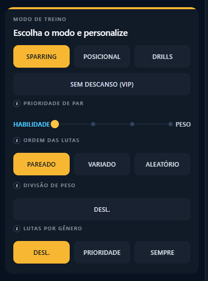
</p>

### Seletor de treino posicional em trios ou duplas

Ao ativar o modo posicional, escolha entre grupos de três pessoas em 6 etapas ou duplas com inversão na metade da rodada.

<p align="center">
  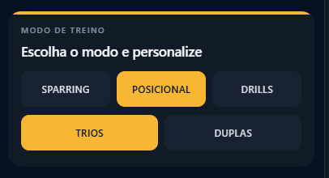
</p>

### Configuração do modo drills

Painel enxuto para repetição técnica mantendo o mesmo parceiro do início ao fim da aula.

<p align="center">
  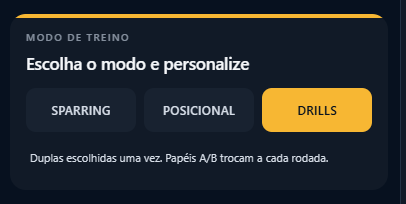
</p>

### Grade de preparação do sparring

Cartões coloridos por categoria com contagem regressiva antes do primeiro gongo.

<p align="center">
  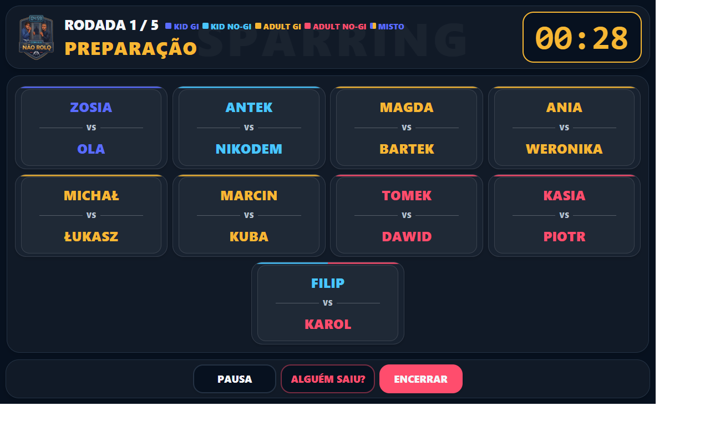
</p>

### Cronômetro de luta em tela cheia

Números grandes visíveis do fundo da academia com botões de pausa, saída de atleta e encerramento.

<p align="center">
  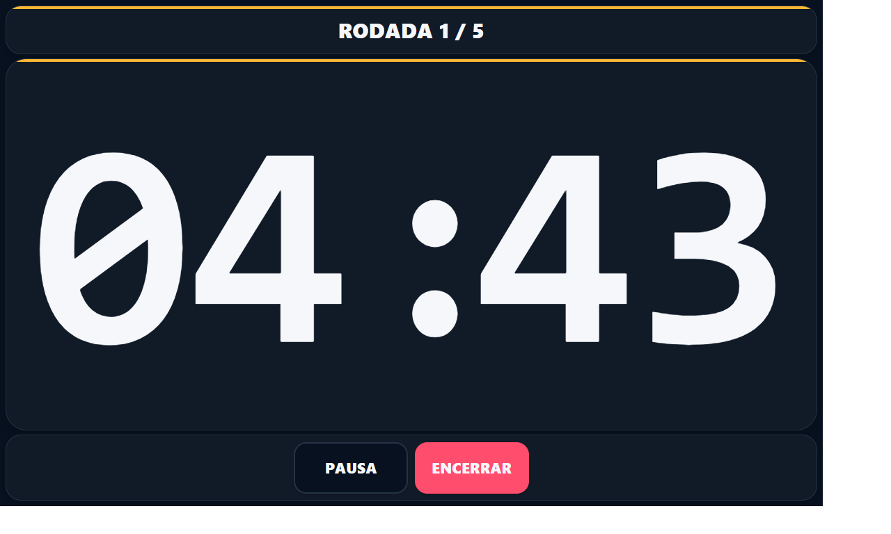
</p>

### Intervalo já mostrando as próximas duplas

Assim que o rola acaba, a tela de descanso já exibe as novas duplas e quem vai descansar na sequência.

<p align="center">
  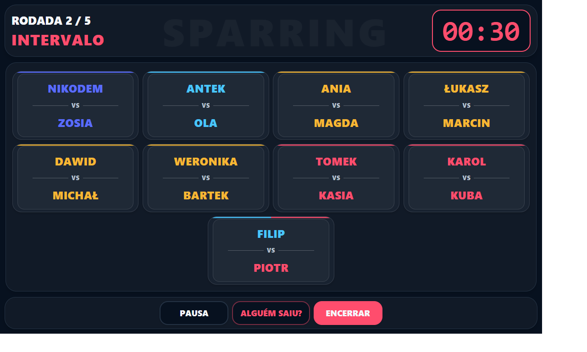
</p>

### Preparação dos trios posicionais

Cartões dos grupos de três atletas destacando quem começa por baixo, por cima e na espera.

<p align="center">
  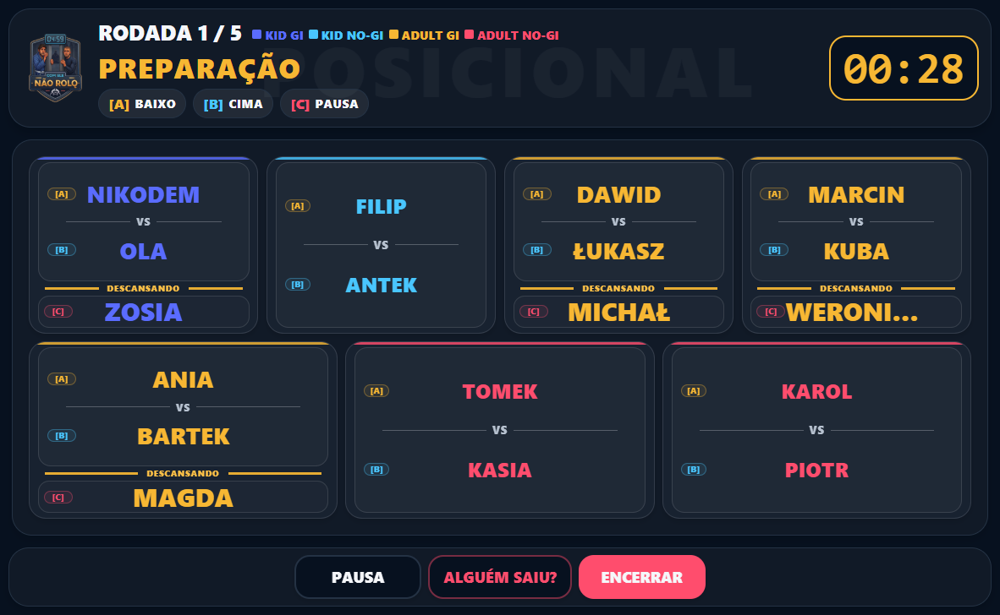
</p>

### Relógio da etapa e aviso da próxima troca nos trios

Contagem da etapa atual mostrando quem está trabalhando agora e quem entra no próximo sinal.

<p align="center">
  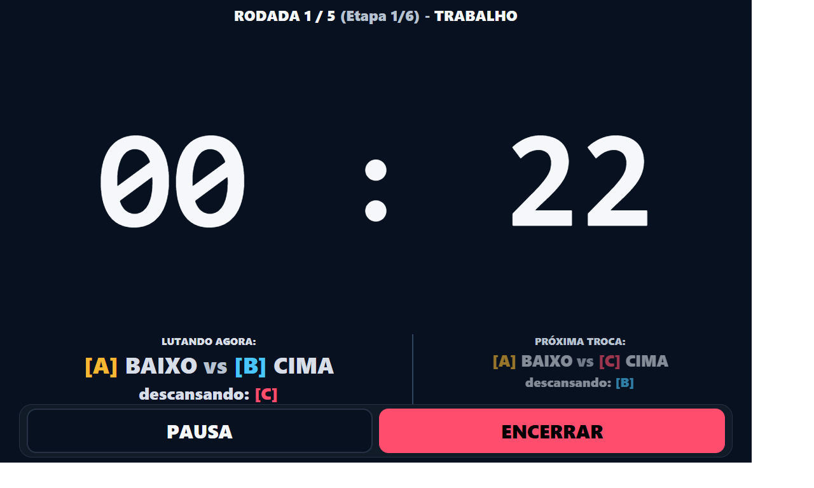
</p>

### Preparação do treino posicional em duplas

Grade limpa com os lados A e B definidos antes do início da rodada.

<p align="center">
  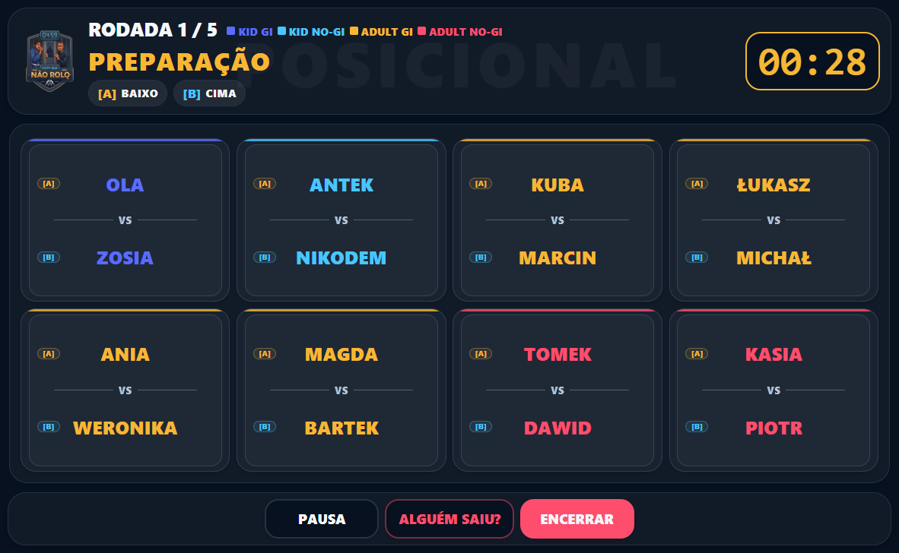
</p>

### Cronômetro do treino posicional em duplas

Relógio da primeira metade com indicação clara da inversão de papéis logo abaixo dos números.

<p align="center">
  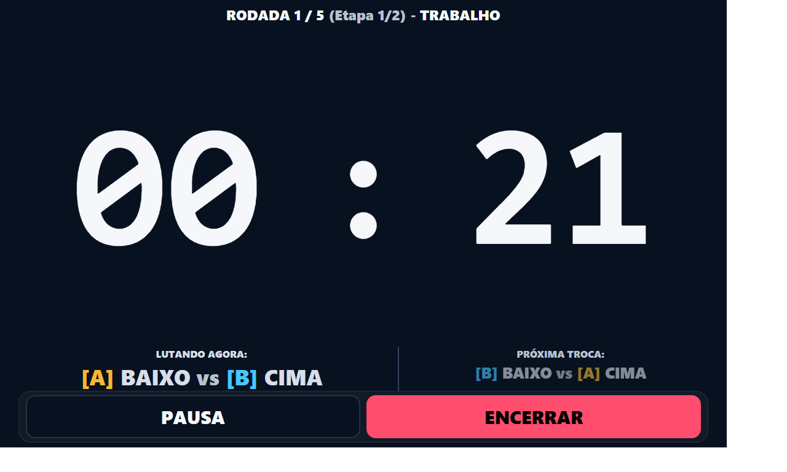
</p>

### Retirada de atleta no meio da aula

Pause o relógio a qualquer momento para tirar quem machucou ou cansou pelo resto do treino ou por apenas uma rodada, recalculando as duplas na hora.

<p align="center">
  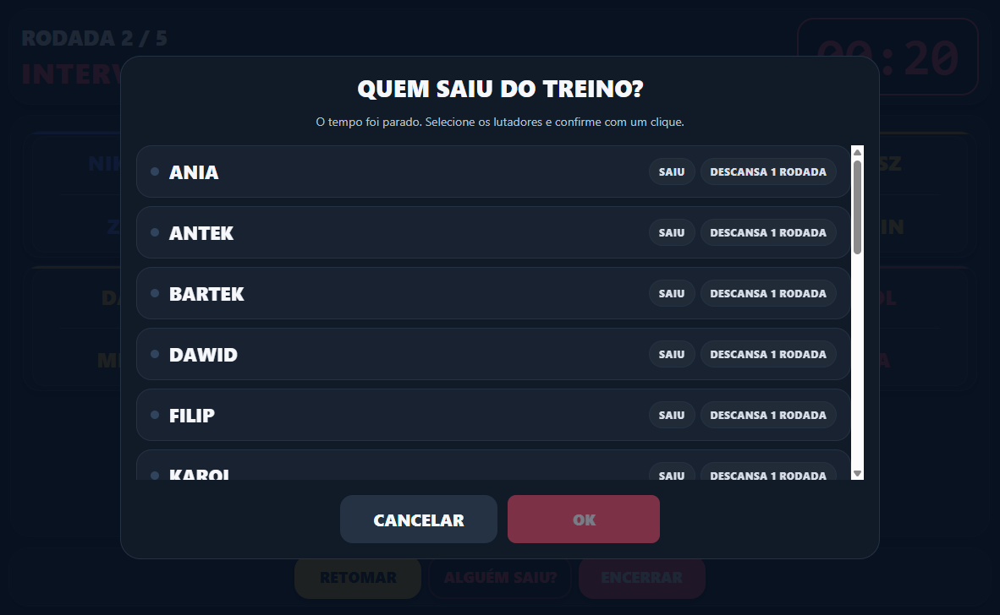
</p>

### Lista de atletas sem descanso

Marque o professor ou os competidores para que o algoritmo nunca os coloque no banco em turmas ímpares.

<p align="center">
  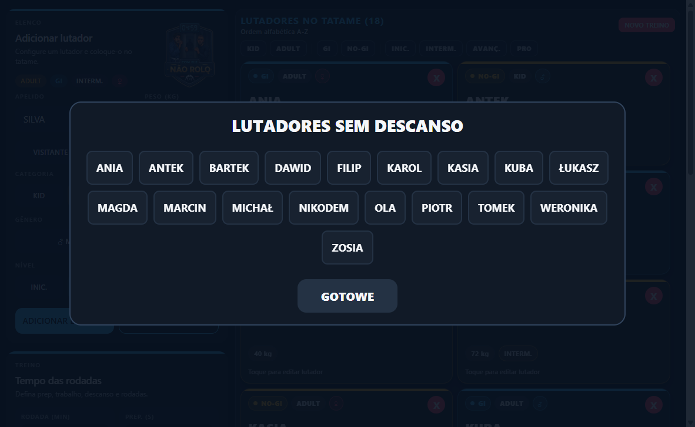
</p>

### Cartão de versão e contato

Janela com o número da versão atual, e-mail direto, repositório no GitHub e atalho para a mantoshop.pl.

<p align="center">
  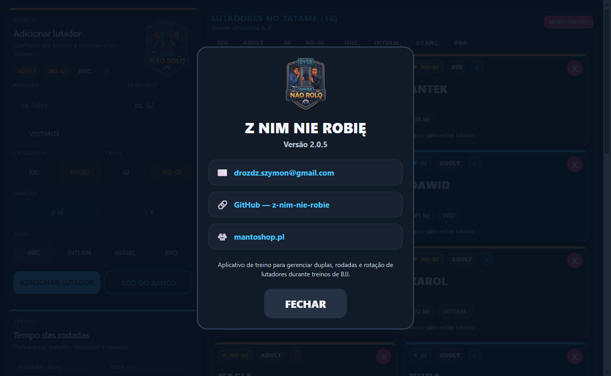
</p>

### Tela de encerramento do treino

Confirmação após o último sinal sonoro com botão direto para voltar às configurações.

<p align="center">
  
</p>

## Tecnologias e estrutura de pastas

| Camada | Solução adotada |
|---|---|
| Plataforma e interface | [Expo SDK 58](https://expo.dev/) e React Native 0.88.1 (React 19.3.1) |
| Linguagem | TypeScript 6.0 |
| Roteamento | Expo Router |
| Armazenamento local | `@react-native-async-storage/async-storage` 3.1 |
| Áudio | `expo-audio` (sem permissão de microfone) |
| Pacotes Android | EAS Build (AAB e APK) |
| Publicação web | Exportação estática do Metro enviada por FTPS para servidor próprio |
| Dispositivos | Tablets Android de 10,5 polegadas, celulares Android e iOS e navegadores |

Principais arquivos do repositório:

```
app/
  _layout.tsx                  # Layout raiz e bloqueio de desligamento da tela
  (tabs)/
    index.tsx                  # Tela inicial, cronômetros, grades de duplas e modais
    i18n.ts                    # Dicionário de traduções PL, EN e PT
    types.ts                   # Tipos de domínio dos lutadores, lutas e opções
    engine/
      matchmaker.ts            # Solver de pareamento (bitmask DP e busca em feixe)
constants/
  training-helpers.ts          # Validação de dados, limpeza do armazenamento e trios
hooks/
  use-safe-keep-awake.ts       # Controle seguro de WakeLock no celular e no navegador
tests/
  engine-and-helpers.test.mjs  # Testes unitários do motor e das funções auxiliares
public/
  .htaccess                    # Regras de rota SPA e cache no Apache
  privacy/index.html           # Página estática da política de privacidade em 3 idiomas
scripts/
  deploy-web.mjs               # Script de upload FTPS com backup prévio
plugins/
  with-adi-registration.js     # Plugin Expo para verificação de pacote no Google Play
```

## Execução local e geração de pacotes

Instale as dependências com `npm` e rode o servidor de desenvolvimento, a suíte de testes, o linter ou a checagem de tipos:

```bash
npm install
npx expo start

npm test
npm run lint
npx tsc --noEmit
```

Use `npx expo export --platform web` para gerar o pacote web na pasta `dist/` ou `npm run release:web` para publicar direto via FTPS usando `.secrets/ftp.json`. Para gerar o pacote `.aab` de produção e enviar automaticamente ao Google Play, execute `npm run release:android` conforme descrito em [docs/play-store/build-and-submit.md](docs/play-store/build-and-submit.md).

## Versão web e privacidade

O aplicativo roda direto no navegador do computador, tablet ou celular sem instalar nada em [https://znimnierobie.pl](https://znimnierobie.pl).

Nenhum dado sai do aparelho, não há login e o código não carrega rastreadores nem anúncios. Leia a política completa em [docs/privacy-policy.md](docs/privacy-policy.md) ou em [https://znimnierobie.pl/privacy](https://znimnierobie.pl/privacy), e acompanhe as versões em [CHANGELOG.pt-BR.md](CHANGELOG.pt-BR.md).

## Licença

Todos os direitos reservados. Código disponibilizado neste repositório apenas para consulta.

<p align="center">
  <b>Z NIM NIE ROBIĘ</b> · v2.3 · Cronômetro e formador de duplas para BJJ
</p>

